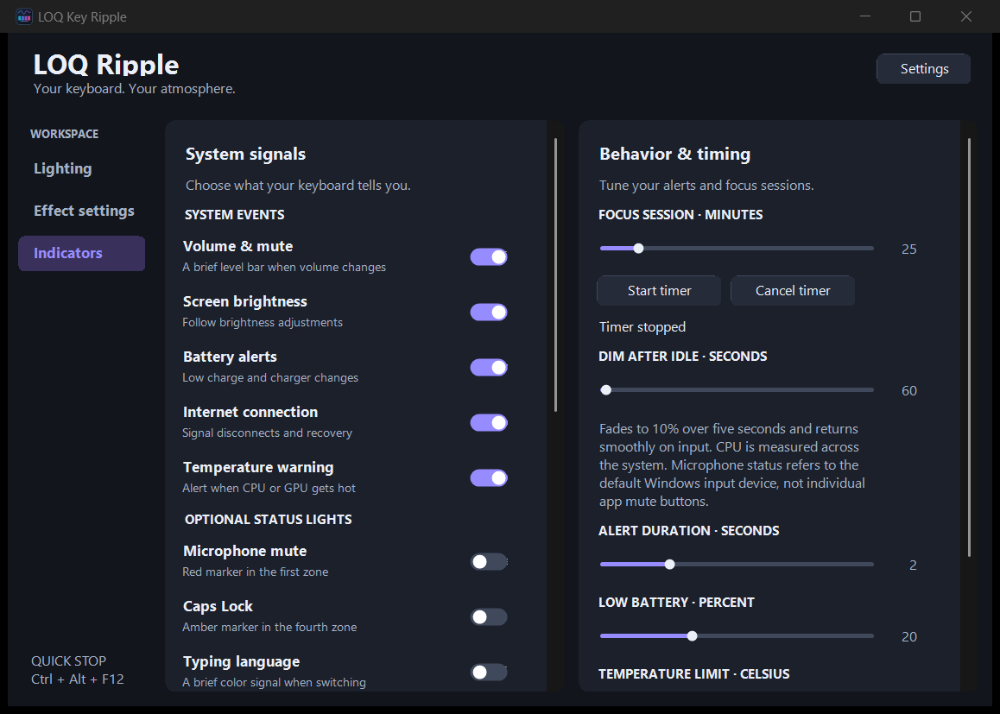

# LOQ Ripple

برنامج ويندوز للتحكم بإضاءة كيبورد **Lenovo LOQ 15IRX9 ذي المناطق الأربع**. يوفّر 42 تأثيرًا، ودمج تأثيرين، وتفاعلًا مع الكتابة والمؤشر والصوت وألوان الشاشة، ومؤشرات اختيارية لحالة الجهاز.

[English](README.md) · [تنزيل نسخة ويندوز](https://github.com/IbrahimSaadi/LoqRipple/releases/download/v0.1.0/LoqRipple-v0.1.0-windows.zip)



## التشغيل

نزّل المشروع ثم شغّل **Start.cmd** على ويندوز. يبني الملف التنفيذي عند الحاجة باستخدام مترجم .NET Framework المثبّت في ويندوز، دون حزم NuGet.

```powershell
powershell.exe -NoProfile -ExecutionPolicy Bypass -File .\Build.ps1
.\LoqRipple.exe
```

- **Lighting:** اختيار التأثير الأساسي والثانوي، نسبة الدمج، السطوع العام وردود فعل الكتابة والنقر.
- **Effect settings:** إعدادات مستقلة لكل تأثير في كل طبقة؛ السرعة والألوان والتنعيم والحساسية وغيرها بحسب التأثير.
- **Indicators:** تنبيهات الصوت والسطوع والبطارية والإنترنت والحرارة، ومؤشرات الكتم وCaps Lock واللغة والتركيز واستخدام المعالج والشحن والخمول.
- **Settings → Appearance:** مظهر فاتح أو داكن أو متابعة مظهر تطبيقات ويندوز تلقائيًا.

## التوافق

اختُبر مع Lenovo LOQ 15IRX9، متحكم HID بمعرّف **048D:C993** وصفحة استخدام **FF89** واستخدام **CC**. التوافق مع أجهزة أخرى غير مؤكّد. الإضاءة أربع مناطق وليست لكل مفتاح، وتتبع المؤشر يشمل التاتش باد والماوس وليس إحداثيات الإصبع الخام. تعمل مصادر الحساسات المدعومة فقط؛ لا يعرض البرنامج حرارة وهمية عند تعذّر القراءة.

إذا تنافس مع Vantage أو Windows Dynamic Lighting، أوقف تحكمهما بالإضاءة أثناء استخدامه.

## التأثيرات

التأثيرات الـ42 موزّعة على سبع مجموعات: الكتابة والمفاتيح، التاتش باد والماوس، الحركة والأمواج، الطبيعة والأجواء، الألوان والنبض، الموسيقى والصوت، والشاشة والبطارية. تتوفر القائمة الكاملة في [الملف الإنجليزي](README.md#effects).

**Screen Colors** يأخذ لونًا غالبًا من كل ربع رأسي للشاشة المحددة. الوضع Accurate يحافظ على اللون المستخرج، وVivid يعزّزه. يمكن ضبط التحديث من 100 إلى 3000 مللي ثانية، والتنعيم ومرشّحات الأسود والمحايد. Pure screen colors يمنع طبقات الكتابة والماوس، مع استمرار تنبيهات النظام. اللون الناتج تمثيلي؛ اختلاف مصابيح الكيبورد عن الشاشة يؤثر في المطابقة.

## الحفظ والاختصارات

تُحفظ الإعدادات في `%LOCALAPPDATA%\LoqRipple\settings.xml`. زر X يخفي النافذة بجوار الساعة؛ اختر Exit من قائمة الأيقونة للخروج الكامل. التشغيل مع ويندوز اختياري.

| الاختصار | الوظيفة |
| --- | --- |
| Ctrl + Alt + Left / Right | التأثير السابق أو التالي |
| Ctrl + Alt + Up / Down | السطوع العام |
| Ctrl + Alt + F10 | تشغيل أو إيقاف |
| Ctrl + Alt + F11 | إظهار أو إخفاء النافذة |
| Ctrl + Alt + F12 | إيقاف طارئ |
| Ctrl + Alt + B | عرض البطارية عند تفعيل الخيار |

الإيقاف يحاول استعادة تقرير الإضاءة السابق؛ وإذا تعذّرت قراءته من المتحكم، يستعيد ضوءًا أبيض ثابتًا.

## الخصوصية والاختبارات

يراقب البرنامج أحداث الإدخال لتشغيل الإضاءة. لا يحفظ النصوص أو سجلات المفاتيح أو تسجيلات الصوت أو صور الشاشة، ولا يرسلها عبر الشبكة. التقاط الشاشة وتحليل الصوت في الذاكرة، وحالة الإنترنت تُقرأ من ويندوز دون إرسال فحوص اتصال نشطة.

راجع [تعليمات الاختبارات](README.md#development-and-validation). فحص smoke يفتح جهاز RGB ويغيّر الإضاءة مؤقتًا، بينما فحصا self-test وsettings-test لا يحتاجان الكيبورد. نجحت اختبارات التأثيرات والدمج والحفظ والمؤشرات والواجهة؛ اختبار الاستخدام الطويل والسكون والاستيقاظ الفعلي يبقى معتمدًا على الجهاز.
