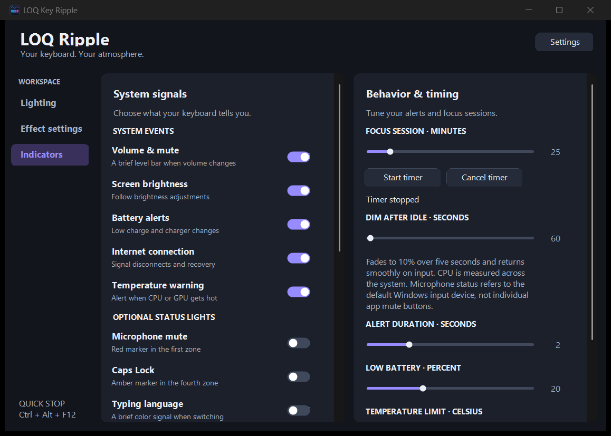
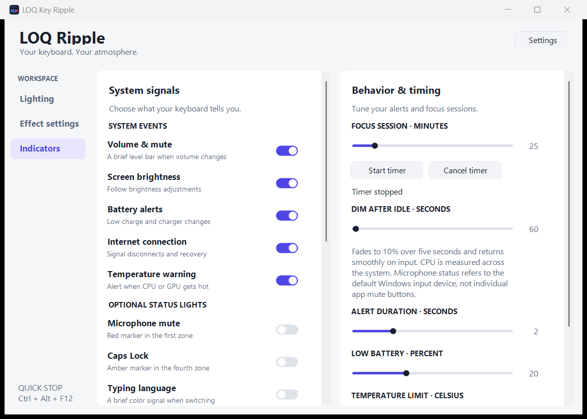

# LOQ Ripple

A lightweight Windows RGB keyboard controller for the **four-zone Lenovo LOQ 15IRX9 keyboard**. Includes **42 effects**, two-layer blending, keyboard and pointer reactions, music and screen colors, and optional system indicators.

[العربية](README.ar.md) · [Download Windows ZIP](https://github.com/IbrahimSaadi/LoqRipple/releases/download/v0.1.0/LoqRipple-v0.1.0-windows.zip)



## Compatibility

- Windows x64 with the .NET Framework C# compiler installed.
- Developed and tested with Lenovo LOQ 15IRX9, USB HID **048D:C993**, vendor usage page **FF89**, usage **CC**.
- Lighting is **four-zone**, not per-key. Key-to-zone mapping is approximate.
- Other Lenovo models and HID controllers are not verified.
- Temperature indicators use supported sensor providers or NVIDIA NVML when available. CPU temperature may be unavailable. CPU activity indicators measure CPU usage, not GPU usage.

## Getting started

1. Download or clone this repository.
2. On Windows, run **Start.cmd**. If needed, it builds `LoqRipple.exe` using the compiler already installed with .NET Framework.
3. Choose an effect in **Lighting** and adjust master brightness.
4. Open **Effect settings** for per-layer speed, palette, motion and effect-specific controls.
5. Enable optional signals in **Indicators**.

Alternatively, build explicitly in Windows PowerShell:

```powershell
powershell.exe -NoProfile -ExecutionPolicy Bypass -File .\Build.ps1
.\LoqRipple.exe
```

If another program controls the keyboard (for example Lenovo Vantage or Windows Dynamic Lighting), pause its lighting control to avoid competing writes. LOQ Ripple does not modify those programs' settings.

## Effects

| Group | Effects |
| --- | --- |
| Typing & keys | Key Ripple, Key Flash, Key Trail, Typing Heat, Hold Charge, Idle Breathing, Key Groups, Color Key Ripple, Typing Build, Typing Echo |
| Touchpad & mouse | Touchpad Follow, Drag Light, Scroll Wave, Double Tap |
| Motion & waves | Meteor, Bounce, Orbit, Scanner, Colliding Waves, Tides, Alternating Zones |
| Nature & atmosphere | Rain, Sparkle, Lightning, Fire, Ocean, Aurora, Lava, Thunderstorm, Embers, Twinkling Stars |
| Colors & pulse | Rainbow Wave, Color Cycle, Breathing, Static, Heartbeat |
| Music & audio | Music Pulse, Music Spectrum, Music Echo, Music Rainbow Wave |
| Screen & battery | Screen Colors, Battery |

Choose an optional second effect and set its blend amount. Both layers keep their own effect settings. Typing and click waves can also overlay the current lighting. Pointer effects follow the Windows cursor from either a touchpad or mouse; they do not read raw finger coordinates.

### Screen Colors

- Four vertical regions cover the selected display.
- **Accurate** preserves the extracted dominant RGB without automatic color boosting. **Vivid** enhances brightness and saturation.
- Configurable black/neutral filtering, sensitivity and transition smoothing.
- Refresh interval: 100–3000 ms, with adaptive throttling when capture is expensive. Existing profiles retain their interval.
- Reuses capture resources and runs capture off the UI thread.
- **Pure screen colors** suppresses keyboard and mouse overlays; system alerts can still appear.

The result is representative lighting, not calibrated color reproduction of the display.

### System indicators

Volume and mute, screen brightness, low battery and charger changes, internet loss/recovery, and high-temperature alerts. Optional status lights include default microphone mute, Caps Lock, input-language changes, battery on demand, focus countdown, CPU activity, charging progress, and idle dimming. Availability depends on Windows and hardware sources; unavailable sensors are not simulated.

Temporary alerts have priority over continuous status colors. Focus progress takes precedence over charging, which takes precedence over CPU colors. Microphone and Caps Lock mark zones 1 and 4. All respect master brightness and manual Stop.

### Profiles, tray and appearance

- Built-in Work, Gaming, Music and Screen profiles, plus named custom profiles.
- Automatic settings persistence in `%LOCALAPPDATA%\LoqRipple\settings.xml`.
- Closing the window hides it in the tray. Choose **Exit** from the tray menu to quit.
- Optional startup with Windows, plus pause on lock/suspend and battery saver.
- **Settings → Appearance → System / Light / Dark**. System follows the Windows app theme automatically.



## Keyboard shortcuts

| Shortcut | Action |
| --- | --- |
| Ctrl + Alt + Left / Right | Previous / next effect |
| Ctrl + Alt + Up / Down | Adjust master brightness |
| Ctrl + Alt + F10 | Start / stop |
| Ctrl + Alt + F11 | Show / hide window |
| Ctrl + Alt + F12 | Emergency stop |
| Ctrl + Alt + B | Show battery level, when enabled in Indicators |

Stop attempts to restore the previous lighting report; if the controller cannot provide it, it restores steady white.

## Privacy

Global keyboard and mouse hooks observe input events for lighting. The application does not write typed text, keystroke logs, screenshots, or audio recordings to disk, and does not transmit them. Screen sampling and audio analysis remain in memory. Internet status is read from Windows; no active connectivity probes are sent by the app.

## Development and validation

`Build.ps1` compiles the C# files directly using Windows .NET Framework. No NuGet dependencies are required. Sources are split into lighting/HID, audio, screen sampling, notifications, utility indicators, effect settings and shared UI components.

```powershell
# Tests without RGB hardware
Start-Process .\LoqRipple.exe --self-test -Wait
Start-Process .\LoqRipple.exe --settings-test -Wait

# Environment / hardware checks
Start-Process .\LoqRipple.exe --probe -Wait
Start-Process .\LoqRipple.exe --screen-test -Wait
Start-Process .\LoqRipple.exe --spectrum-test -Wait
Start-Process .\LoqRipple.exe --indicators-test -Wait
Start-Process .\LoqRipple.exe --utility-test -Wait
Start-Process .\LoqRipple.exe --health-test -Wait

# Opens the RGB device and renders all effects; temporarily changes lighting
Start-Process .\LoqRipple.exe --smoke-test -Wait
```

Exit code 0 indicates success; use `Start-Process -PassThru -Wait` and inspect `ExitCode` in scripts. Smoke tests cover all 42 effects, both layers, settings, grouped selectors, indicator transitions, tray behavior, simulated power/session state, and theme/UI checks. Extended everyday use and actual sleep/resume still require real-device testing.
